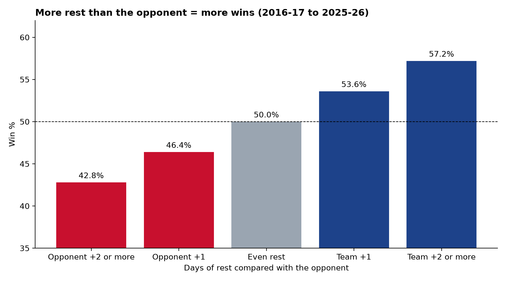
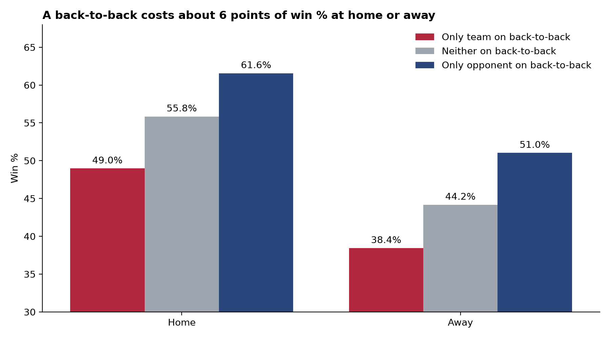

# Does Rest Win NBA Games?

**Finding:** Rest is worth real wins. Across 10 seasons (2016-17 to 2025-26, 24,000 team-games), a team with **2+ more days of rest than its opponent wins 57.2%** of the time, compared with **42.8%** when the opponent has the advantage. With home and away held constant, playing the second night of a back-to-back against a rested team costs **about 6 percentage points of win probability**, roughly **half the value of home court**.

This is the schedule-fatigue context behind the league's load management debate. It's also why teams have long rested stars on back-to-backs, which my [Player Participation Policy analysis](https://github.com/adn42-ui/nba-load-management-analysis) examines.





| Situation (team's view) | Games | Win % |
|---|---|---|
| Opponent has 2+ more days of rest | 1,166 | 42.8% |
| Opponent has 1 more day | 4,492 | 46.4% |
| Even rest | 12,324 | 50.0% |
| Team has 1 more day | 4,492 | 53.6% |
| Team has 2+ more days | 1,166 | 57.2% |
| Home, only the team on a back-to-back | 1,213 | 49.0% (vs 55.8% with neither) |
| Away, only the team on a back-to-back | 1,876 | 38.4% (vs 44.2% with neither) |

## Pipeline

```
stats.nba.com ─► load_raw.py ─► DuckDB (raw) ─► dbt models ─► export.py ─► Tableau / charts
```

The modeling follows the standard dbt layers. Each layer does one job, and every model is tested.

| Layer | Model | What it does | Key SQL |
|---|---|---|---|
| Staging | `stg_team_games`, `stg_player_games` | Rename columns to snake_case, fix types, derive home/away and win flags | CTEs, `CAST`, `LIKE` |
| Intermediate | `int_team_rest` | Days of rest before every game for each team | Window function: `LAG() OVER (PARTITION BY team, season ORDER BY date)` |
| Marts | `fct_team_games` | Pairs each team with its opponent's rest; rest advantage and buckets | Self-join, `CASE WHEN` |
| Marts | `agg_win_rate_by_rest` | Games, wins, win % and margin by season, venue and rest situation | `GROUP BY`, conditional aggregation |

### Data tests (16, all passing)
Built-in `not_null` and `accepted_values` tests, plus custom SQL tests that check the logic itself:
- **`one_row_per_team_per_game`:** no duplicated team-games in staging
- **`days_rest_never_negative`:** the window function never puts games out of order
- **`two_teams_per_game`:** the self-join produces exactly two rows per game, no more and no fewer
- **`rest_advantage_is_mirrored`:** if one team is +2, its opponent is −2 in the same game

## Tools
- **DuckDB:** a local analytical database. It uses the same SQL as Snowflake, so moving to Snowflake only needs a new target in `profiles.yml`.
- **dbt Core:** models, dependency graph, documentation and tests
- **Python:** data loading, exports, charts
- **Tableau Public:** interactive dashboard *(in progress)*

## How to run

```bash
pip install duckdb dbt-duckdb pandas matplotlib seaborn
python load_raw.py        # load the CSVs in data/raw/ into nba.duckdb
.\dbt build               # build all models and run all tests (Windows shortcut for dbt)
python export.py          # write exports/*.csv for Tableau and figures/*.png
```

The raw game logs come from [`nba_api`](https://github.com/swar/nba_api), downloaded by `src/pull_data.py` in the [load management project](https://github.com/adn42-ui/nba-load-management-analysis). Copy `team_logs_*.csv` and `player_logs_*.csv` into `data/raw/`. Raw data and the database file are not committed.

## Limitations
- **Rest isn't randomly assigned.** The schedule decides back-to-backs, and travel often comes with them. The back-to-back penalty includes travel fatigue, not rest alone.
- **Team quality isn't controlled for** beyond home/away. Across thousands of games, schedule effects affect good and bad teams alike, so this matters less than it might, but a regression with team strength would sharpen the estimate.
- **The 2020 bubble restart** created months-long "rest" gaps. These fall into the 3+ days bucket.

## Repo structure
```
models/staging/       stg_team_games, stg_player_games + tests
models/intermediate/  int_team_rest
models/marts/         fct_team_games, agg_win_rate_by_rest
tests/                custom SQL data tests
exports/              CSVs for Tableau
figures/              charts
```

---
*Akachidike David Nweze, Data Science, New Jersey Institute of Technology* · [GitHub](https://github.com/adn42-ui) · [adn42@njit.edu](mailto:adn42@njit.edu)
